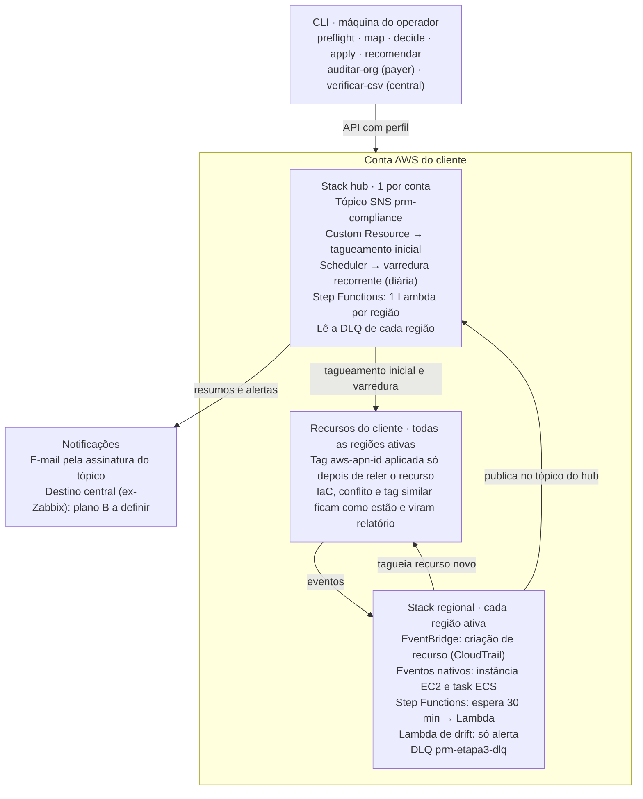

# Automação de Tagueamento AWS PRM — MVP 1

02/10/2026 · Cópia em Markdown do documento compartilhado "Automação de Tagueamento AWS PRM — MVP 1".

## Visão geral

A automação aplica e mantém a tag `aws-apn-id = pc:<product code>` em todos os recursos elegíveis das contas dos clientes, para que o consumo AWS desses recursos seja atribuído à Darede no programa **AWS Partner Revenue Measurement (PRM)**, pelo método de *resource tagging*.

Ela resolve quatro problemas, nesta ordem:

1. **Descobrir** tudo o que existe na conta, inclusive recursos que nunca tiveram tag nenhuma (invisíveis à API de tags da AWS).
2. **Decidir** o que pode ser tagueado sem risco: recursos gerenciados por IaC, com o valor de outro parceiro ou com uma tag parecida ficam de fora e viram relatório.
3. **Aplicar** a tag nos recursos existentes (tagueamento inicial) e em cada recurso novo, em minutos (reação em tempo real).
4. **Manter**: alertar quando alguém remove a tag, varrer a conta periodicamente e apontar o que precisa ser configurado na origem (EKS, ECS, DRS, IoT).

Cobre 90 dos 92 códigos de serviço da lista oficial de serviços incluídos no PRM (94 linhas, atualizada em 30/09/2026). Tudo é publicado num tópico SNS por conta, hoje entregue por e-mail.

## Status do MVP 1

Os 15 pontos do handover estão implementados; só a integração com o Zabbix ficou fora (decisão do time, plano B a definir). A coluna Validação diz onde cada ponto foi provado: **AWS real** = conta sandbox da Darede, 30/09 a 02/10/2026; **local** = testes automatizados com AWS simulada (505 testes, sem conta).

| # | Ponto do handover | Como foi resolvido | Validação |
| --- | --- | --- | --- |
| 1 | Descoberta de recursos sem tag | Listagem pelas APIs de cada serviço (~50), unida à API de tags | AWS real (197 e 49 recursos achados em us-east-1/us-east-2); ajuste de S3 na Lambda: local |
| 2 | Etapa 2a (decisão) | Mantida; regras de IaC, conflito, tag similar | AWS real |
| 3 | Etapa 2b (dry-run) | Mantida | AWS real |
| 4 | Etapa 2c (escrita) | Validada com 10 cenários e releitura da tag | AWS real (10/10) |
| 5 | Etapa 3: demais recursos e regiões | 90 dos 92 serviços do CSV; uma stack por região | AWS real (Lambda, DynamoDB, IoT, S3) |
| 6 | Etapa 4 | Varredura recorrente, alerta de drift, auditoria de SCP/tag policy, verificação do CSV oficial | AWS real (drift, varredura, CSV); auditoria de SCP: local |
| 7 | Split hub/regional | `template-hub.yaml` + `template-regional.yaml` | AWS real (deploy em 2 regiões); publicação entre regiões: local |
| 8 | Custom Resource assíncrono | Dispara o tagueamento inicial por região, em paralelo | AWS real (dry-run); modo live: local |
| 9 | SQS e DLQ | DLQ por região, recebe falha de entrega e de processamento | AWS real |
| 10 | 16 serviços sem mapeamento | 14 mapeados conforme validação do time; DRS e CodeStar sem evento, por decisão | AWS real (IoT); demais conferidos contra o modelo do SDK |
| 11 | CreateFleet/Karpenter, restores, volume root | Evento nativo de EC2 + expansão para volumes; restores de RDS e DynamoDB | Local |
| 12 | Caminhos do guia para EKS | Subcomando `recomendar` gera o ajuste por cluster | AWS real (execução); achados de EKS: local |
| 13 | Nodes EKS como Amazon EC2 | Campo `servico_faturamento` no relatório; nodes via evento nativo | Local |
| 14 | Tasks ECS | Tag na task via `ecs:TagResource`; `propagateTags` como recomendação | AWS real (recomendação); evento de task: local |
| 15 | CSV × PDF | CSV regenerado da página oficial (94 linhas) | AWS real (`verificar-csv` contra a página) |

Além dos 15 pontos, o trabalho corrigiu bugs que impediam o funcionamento real: Lambda nunca era tagueada pela Etapa 3 (nome de evento versionado), leitura de eventos em camelCase, permissões ausentes na Lambda do hub e ruído de e-mail em regiões bloqueadas por SCP.

## Arquitetura

A automação é um único código Python (`aws_prm_tagging/`) usado de duas formas: dentro das Lambdas de duas stacks CloudFormation implantadas na conta do cliente, e como CLI na máquina de quem opera. A stack regional é a que reage em tempo real.



A stack hub existe uma vez por conta e concentra o que é único: o tópico de notificação, o tagueamento inicial e a varredura. A stack regional existe em cada região ativa, sempre incluindo `us-east-1`, a única onde chegam os eventos de serviços globais como Route 53 e CloudFront.

| Etapa | O que faz | Onde roda |
| --- | --- | --- |
| 1 — Descoberta | Inventário com status da tag, inclusive recursos nunca tagueados | CLI `map` e Lambda do hub |
| 2a — Decisão | Taguear, pular IaC, conflito, tag similar, já ok | CLI `decide` e Lambda do hub |
| 2b/2c — Execução | Simulação ou escrita, relendo cada recurso antes | CLI `apply` e Lambda do hub |
| 3 — Tempo real | Taguear cada recurso novo | Stack regional |
| 4 — Manutenção | Drift, varredura, auditoria de SCP, verificação do CSV | Regional, hub e CLI |

## Como funciona

Todo recurso passa pela mesma decisão, venha ele do tagueamento inicial, da reação em tempo real ou da varredura. A decisão é tomada duas vezes: no relatório e de novo, relendo as tags reais, imediatamente antes de escrever.

| Situação do recurso | Decisão | O que acontece |
| --- | --- | --- |
| Sem `aws-apn-id` | `taguear` | Recebe a tag (em dry-run, só aparece no relatório) |
| Já tem o valor certo | `ja_ok` | Nada |
| Tem `aws-apn-id` com outro valor | `conflito` | Nada; vira relatório (pode ser de outro parceiro) |
| Tem chave parecida (`AWS-APN-ID`, `aws_apn_id`) | `revisar_tag_similar` | Nada; revisão humana |
| Gerenciado por IaC (CloudFormation, Terraform, CDK...) | `pulado_iac` | Nada; o ajuste deve ir para o código do cliente |

A escrita é restrita pelo IAM: a automação só consegue criar a chave `aws-apn-id` (condição `aws:TagKeys`), nunca alterar ou remover outras tags.

**Tagueamento inicial.** Ao criar a stack hub, um Custom Resource dispara um Step Functions que roda, em até 4 regiões em paralelo, uma Lambda por região com o fluxo completo: descoberta, decisão e escrita. Em `dry-run` (padrão) nada é escrito e cada região manda um resumo por e-mail; em `live` a tag é aplicada.

**Reação em tempo real (Etapa 3).** Em cada região, regras do EventBridge escutam a criação de recursos dos 90 serviços mapeados (via CloudTrail) e dois eventos nativos: instância EC2 em execução e task Fargate em execução. Depois de um intervalo de 30 minutos, para não competir com o IaC que ainda está aplicando tags, a Lambda relê o recurso e aplica a tag se for o caso. Instâncias levam junto os volumes EBS anexados; tasks ECS não esperam o intervalo.

**Alerta de drift (Etapa 4).** Quando alguém remove ou troca tags, a automação relê o recurso e, se a `aws-apn-id` sumiu ou mudou, manda um alerta com quem fez a chamada. Ela não reaplica sozinha: isso fica com a varredura em modo `live`, para não brigar com uma remoção intencional.

**Varredura recorrente (Etapa 4).** Diariamente (padrão), a mesma state machine do tagueamento inicial roda de novo. Cada região só manda e-mail quando há novidade: algo a taguear, conflito, falha, mensagem na DLQ, região sem stack regional ou contrato não confirmado. Regiões bloqueadas por SCP não geram e-mail.

**Recomendações na origem.** Para o que a tag reativa não alcança de forma durável, o subcomando `recomendar` gera o ajuste pronto para o IaC do cliente: launch template e Karpenter no EKS, Load Balancer Controller, driver EBS CSI, `propagateTags` no ECS, `stagingAreaTags` no DRS e billing groups do IoT.

## Pré-requisitos

**Do cliente:**

- Contrato definido: o `pc:<product code>` que vale para a conta (ou para a OU, no rollout em massa).
- Consentimento por escrito antes de qualquer modo `live` em recursos existentes — exigência do guia do PRM.
- Uma trail do CloudTrail registrando eventos de gerenciamento de escrita (a trail da organização serve). Sem ela, a Etapa 3 só reage a instâncias EC2 e tasks ECS. O `preflight` verifica isso.
- Para o rollout em várias contas: acesso administrativo à conta de gerenciamento (payer), para ativar o *trusted access* do StackSets.

**Da máquina de quem implanta** (Linux, macOS ou WSL):

| Ferramenta | Para quê | Como instalar |
| --- | --- | --- |
| Python 3.10+ e `pip install -r aws_prm_tagging/requirements-dev.txt` | CLI e testes | `pip` |
| AWS CLI v2 | credencial e comandos | instalador oficial da AWS |
| SAM CLI | build e deploy das stacks | instalador oficial (`aws-sam-cli-linux-x86_64.zip`) |
| `make` | build das Lambdas | `sudo apt-get install -y make` |

**Permissões de quem implanta:** criar stacks do CloudFormation com roles IAM (`CAPABILITY_IAM`), Lambda, Step Functions, EventBridge, SQS, SNS e Scheduler. Na prática, um perfil administrativo da conta. As roles que a automação cria para si mesma têm só leitura, mais a escrita da tag `aws-apn-id`.

## Como implantar numa conta de cliente

O script `deploy/implantar_conta.sh` faz tudo: preflight, plano, confirmação, stack hub e uma stack regional por região ativa. Rodar a partir da pasta que contém o `Makefile`. O caminho seguro tem duas fases: primeiro tudo em dry-run, depois o live, com consentimento.

1. **Entrar na conta do cliente** com um perfil administrativo:

    ```bash
    aws login                     # ou aws sso login --profile <perfil>
    export P=<perfil>
    ```

2. **Ver o plano sem executar nada:**

    ```bash
    deploy/implantar_conta.sh --profile $P --valor pc:<product-code> --email <email> --somente-mostrar
    ```

    Roda o preflight (somente leitura) e lista a conta, as regiões e os comandos. Se aparecer aviso de região sem trail, resolva com o cliente antes de seguir.

3. **Implantar em dry-run:**

    ```bash
    deploy/implantar_conta.sh --profile $P --valor pc:<product-code> --email <email>
    ```

    Pede confirmação (digitar `sim`). Ao terminar, mostra as regiões implantadas e as que falharam. Região bloqueada por SCP falha sem afetar as outras.

4. **Confirmar a assinatura** no e-mail que a AWS envia. Sem isso, nenhum relatório chega.

5. **Revisar os resumos do tagueamento inicial**, um e-mail por região: quantos recursos seriam tagueados, conflitos, IaC e falhas. A partir deste ponto a Etapa 3 já tagueia os recursos **novos**.

6. **Com o consentimento do cliente, aplicar nos recursos existentes:**

    ```bash
    deploy/implantar_conta.sh --profile $P --valor pc:<product-code> --email <email> \
      --modo-inicial live --reexecutar 2 --contrato-confirmado
    ```

    `--reexecutar 2` é o que dispara a nova execução; trocar só o modo não roda nada, de propósito. Para que a varredura diária também reaplique a tag quando ela sumir, inclua `--modo-varredura live`.

7. **Gerar as recomendações de origem** e enviar ao cliente:

    ```bash
    python3 -m aws_prm_tagging.main recomendar --profile $P --expected-tag-value pc:<product-code> \
      --output prm_recomendacoes.json --markdown prm_recomendacoes.md
    ```

O script deixa os artefatos de build no bucket `aws-sam-cli-managed-default` de cada região (prefixo `prm-tagging/`), criado pelo SAM se ainda não existir. Custo: centavos de armazenamento.

## Rollout em várias contas

No MVP 1 o caminho suportado é **conta por conta, com o script**: um perfil por conta (SSO ou role) e uma execução do `implantar_conta.sh` para cada uma. Funciona hoje e foi o caminho validado na sandbox.

```bash
for P in cliente-conta-a cliente-conta-b; do
  deploy/implantar_conta.sh --profile $P --valor pc:<product-code> --email <email> --sim
done
```

**StackSets (desenho original, pendente para o MVP 2).** O plano é implantar a partir da payer do cliente: um StackSet do hub (uma região por conta) e um StackSet regional (todas as regiões), com `ExpectedTagValue` por OU e implantação automática em contas novas. O que já está pronto e o que falta:

| Peça | Estado |
| --- | --- |
| Templates hub e regional prontos para StackSets (sem nomes fixos que colidam entre contas) | Pronto |
| Lista de regiões por conta (`preflight`) | Pronto |
| *Trusted access* do StackSets na payer (`aws cloudformation activate-organizations-access`) | Passo operacional; a Darede tem o acesso |
| Artefatos das Lambdas em um bucket **por região**, legível pela organização, e template apontando para o bucket da região | **Falta** — a Lambda só lê código de bucket da própria região; o `sam package` gera um bucket fixo |
| Mapeamento OU → contrato (`pc:` por OU) | **Falta** — informação de negócio |

Com o mapeamento OU → contrato definido, a peça técnica que falta leva cerca de um dia: criar os buckets regionais com política para a organização, publicar os artefatos e parametrizar o `CodeUri`.

## Operação no dia a dia

O comportamento é controlado por parâmetros das stacks. O script cobre os principais; os demais se mudam com `sam deploy ... --parameter-overrides`.

| Parâmetro | Stack | Padrão | Para que serve |
| --- | --- | --- | --- |
| `ExpectedTagValue` | ambas | — (obrigatório) | Valor `pc:` da tag |
| `ModoTagueamentoInicial` | hub | `dry-run` | `dry-run`, `live` ou `desligado` |
| `ReexecutarTagueamentoInicial` | hub | `1` | Mudar o valor roda o tagueamento inicial de novo |
| `ModoVarreduraRecorrente` | hub | `dry-run` | `live` reaplica a tag onde ela sumiu; `desligado` remove o agendamento |
| `AgendaVarredura` | hub | `rate(1 day)` | Frequência da varredura |
| `ContratoConfirmado` | hub | `false` | `false` faz todo resumo sinalizar contrato não confirmado |
| `PublicarVarreduraSemNovidade` | hub | `false` | `true` manda e-mail diário mesmo sem novidade |
| `RegioesVarredura` | hub | todas | Restringe tagueamento inicial e varredura (ex.: cliente com SCP de região) |
| `NotificationEmail` | hub | placeholder | Destino dos e-mails |
| `DebounceSeconds` | regional | `1800` | Espera antes de agir sobre um recurso novo |
| `PublicarResultadoJaOk` | regional | `true` | `false` evita e-mail por task ECS que já nasce com a tag |
| `FiltroEscopoTeste` | regional | vazio | **Só para conta compartilhada de teste**; vazio em cliente |

**E-mails que chegam** (assunto → significado):

| Assunto | Significado | Ação |
| --- | --- | --- |
| `PRM Etapa 3 - tagueado_sucesso` | Recurso novo recebeu a tag | Nenhuma |
| `PRM Etapa 3 - conflito` / `revisar_tag_similar` / `pulado_iac` | Recurso novo não foi tagueado, de propósito | Revisar com o cliente; IaC → ajustar o código dele |
| `PRM Etapa 3 - falhou` | Escrita falhou (o detalhe traz o erro da AWS) | Ver permissão ou tipo de recurso |
| `PRM Etapa 4-drift - drift_tag_removida` / `drift_tag_alterada` | Alguém removeu ou trocou a tag; traz quem | Confirmar se foi intencional |
| `PRM Etapa tagueamento_inicial - resumo <região>` | Resultado do tagueamento inicial por região | Revisar antes do live |
| `PRM Etapa varredura_recorrente - resumo <região>` | Varredura achou novidade | Ver `por_categoria`, `dlq_mensagens`, `stack_regional_detectada` |
| `PRM tagueamento inicial - FALHA em uma regiao` | A Lambda da região falhou (ex.: passou de 15 min) | Rodar o CLI só para aquela região |

**DLQ.** Cada região tem a fila `prm-etapa3-dlq` com eventos que não puderam ser processados (14 dias de retenção). A varredura avisa quando há mensagem. Para inspecionar: `aws sqs receive-message --queue-url <url> --region <região>`.

**Região grande demais para 15 minutos.** Se o tagueamento inicial de uma região estourar o limite da Lambda, rode pelo CLI: `map --regioes <região>`, depois `decide` e `apply --live`.

## Referência do CLI

O CLI (`python3 -m aws_prm_tagging.main <subcomando>`) roda a partir da pasta do `Makefile`, com `--profile` apontando para a conta. É o mesmo código das Lambdas; serve para auditoria, casos pontuais e regiões grandes demais para a Lambda.

| Subcomando | Escreve na AWS? | O que faz | Opções principais |
| --- | --- | --- | --- |
| `preflight` | Não | Regiões para implantar (ativas + us-east-1) e trail por região. Saída 2 = região sem trail | `--profile`, `--output` |
| `map` | Não | Etapa 1: inventário com status da tag, inclusive recursos nunca tagueados | `--expected-tag-value`, `--regioes`, `--sem-descoberta-nativa`, `--output` |
| `decide` | Não (nem chama a AWS) | Etapa 2a: decisão por recurso a partir do `map` | `--input`, `--expected-tag-value`, `--output` |
| `apply` | Só com `--live` | Etapa 2b (simulação) ou 2c (escrita), relendo cada recurso antes | `--input`, `--live`, `--somente-arns <arquivo>`, `--max-decision-age-hours` |
| `recomendar` | Não | Ajustes de origem para o IaC do cliente (EKS, ECS, DRS, IoT), em JSON e Markdown | `--expected-tag-value`, `--regioes`, `--markdown` |
| `auditar-org` | Não | SCPs e tag policies que bloqueiam ou conflitam com a tag. Exige credencial da payer. Saída 2 = revisar | `--expected-tag-value`, `--output` |
| `verificar-csv` | Não (nem usa credencial) | Compara o CSV embutido com a página oficial do PRM. Saída 3 = a lista mudou | `--url`, `--output` |

Exemplo de ciclo manual numa região, escrevendo só em recursos escolhidos:

```bash
python3 -m aws_prm_tagging.main map --profile $P --expected-tag-value pc:<code> --regioes sa-east-1 --output mapa.json
python3 -m aws_prm_tagging.main decide --input mapa.json --expected-tag-value pc:<code> --output decisao.json
python3 -m aws_prm_tagging.main apply --profile $P --input decisao.json --output simulacao.json          # dry-run
python3 -m aws_prm_tagging.main apply --profile $P --input decisao.json --live --somente-arns arns.txt --output resultado.json
```

Rode o `verificar-csv` periodicamente, de forma central. Quando ele acusar mudança, o CSV embutido e o mapeamento de eventos precisam ser atualizados e reimplantados.

## Segurança e salvaguardas

A automação foi desenhada para nunca causar dano ao cliente, mesmo quando algo dá errado:

- **Só escreve uma chave.** O IAM das Lambdas permite criar apenas a tag `aws-apn-id` (condição `aws:TagKeys`) e não tem nenhuma permissão de remover tags, alterar configuração de recursos ou de `ecs:UpdateService`.
- **Nunca sobrescreve.** Antes de cada escrita, relê o recurso. Valor de outro parceiro, chave parecida ou recurso de IaC são preservados e reportados.
- **Dry-run por padrão.** Tagueamento inicial e varredura começam em `dry-run`; o live exige trocar o parâmetro e mudar `ReexecutarTagueamentoInicial`. O alerta de drift nunca reaplica sozinho.
- **Não altera o IaC do cliente.** Recursos de CloudFormation, Terraform e CDK são pulados; os ajustes vão como recomendação.
- **Remover não desfaz nada.** Apagar as stacks não remove tags já aplicadas.
- **Sem acesso cross-account.** Tudo roda dentro da conta do cliente; nenhuma role de fora é criada.
- **Erros visíveis.** Toda falha vira e-mail ou mensagem na DLQ; região bloqueada por SCP ou bucket negado não derrubam o resto.
- **Proteção de conta compartilhada.** `FiltroEscopoTeste` e `apply --somente-arns` limitam a escrita a recursos de teste. Usados na validação, desligados em cliente.
- **Testes como guarda.** 505 testes automatizados, incluindo verificação de cada campo de evento contra o modelo do SDK, sincronia dos templates com o mapeamento, sincronia de permissões entre hub e regional e consistência de ARN com a API de tags.

## Limitações conhecidas e pendências

**Para o MVP 2:**

| Pendência | Impacto | Próximo passo |
| --- | --- | --- |
| Centralização de métricas e eventos (Zabbix corporativo indisponível) | Resultados chegam só por e-mail, conta a conta | Definir destino; proposta: cada conta publica num barramento do EventBridge de uma conta central da Darede, que grava em S3 para consulta e painel |
| Rollout via StackSets | Implantação conta a conta | Buckets de artefato por região + mapeamento OU → contrato (ver Rollout) |
| SDK da AWS embutido nas Lambdas é o do runtime, mais antigo | Já causou um bug de S3, corrigido; APIs muito novas podem falhar isoladamente na descoberta | Empacotar o boto3 atual junto com as Lambdas |

**Implementado, mas ainda não provado na AWS real** (coberto por testes automatizados):

- Os 3 ajustes de 02/10 na Lambda do hub: S3 por região, releitura de EKS, regiões bloqueadas por SCP. Validação sugerida: implantar só o hub e rodar uma varredura (cerca de 15 minutos).
- Publicação de uma região em tópico de outra região (hub e regional em regiões diferentes).
- Modo `live` do tagueamento inicial e da varredura (provado só na simulação, porque a sandbox é compartilhada).
- Evento nativo de instância EC2 com volumes root e evento de task ECS (exigem recursos com custo por hora).
- `auditar-org` (exige credencial da payer) e recomendações de EKS num cluster real.

**Comportamentos a conhecer:**

- `sam deploy` volta para o padrão qualquer parâmetro não informado. Ao rodar o script de novo, parâmetros ajustados à mão (ex.: `AgendaVarredura`) precisam ser repassados.
- Recursos efêmeros (jobs do SageMaker, Glue e Comprehend, clusters EMR transitórios) terminam antes do intervalo de 30 minutos. O caminho é a tag na origem.
- SES, QuickSight e IoT cobram por uso (e-mail, usuário, mensagem), não pelo recurso; a tag pode não atribuir todo o consumo. O SES também está na lista do método User Agent String do PRM.
- DRS e CodeStar não têm reação por evento, por decisão: o source server do DRS não tem API de criação e o CodeStar foi descontinuado.
- Load balancers do EKS: o AWS Load Balancer Controller pode remover tags aplicadas por fora. Use o `defaultTags` do controller (sai no `recomendar`).
- Região com tanto recurso que a Lambda passa de 15 minutos: o e-mail de falha avisa; rode o CLI para aquela região.

## Como remover

`deploy/remover_conta.sh` procura a stack regional em todas as regiões ativas, remove as regionais e depois o hub. Pede confirmação.

```bash
deploy/remover_conta.sh --profile $P                  # stacks; lista os log groups que sobraram
deploy/remover_conta.sh --profile $P --apagar-logs    # também apaga os log groups das Lambdas
```

O script só apaga log groups com os prefixos exatos das stacks (`/aws/lambda/prm-hub-` e `/aws/lambda/prm-regional-`), nunca outros.

Ficam na conta, de propósito: as tags `aws-apn-id` já aplicadas, e a stack `aws-sam-cli-managed-default` com os artefatos sob `prm-tagging/`, porque ela pode ser usada por outros deploys. Se ela foi criada só para esta automação, pode ser removida esvaziando o bucket (com as versões) e apagando a stack.
